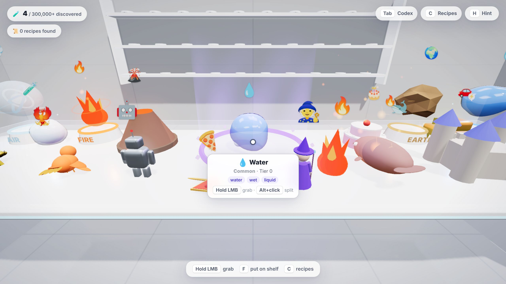
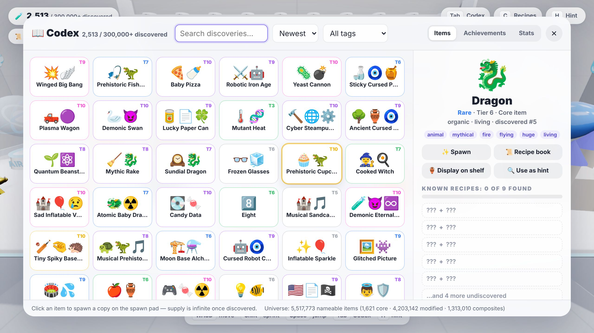

# ⚗️ Elemental Lab — Infinite Craft in 3D

A first-person physics crafting sandbox that runs in the browser. You stand in a bright white lab with four glowing
pedestals (💨 Air, 🔥 Fire, 🌍 Earth, 💧 Water). Grab copies of the elements, toss them, smash them together, and fuse
your way through **more than 300,000 nameable items** (about 1 million, counting every sensible modifier pair and composite).

**▶ Play online, free: https://natguy121.github.io/infintecraft3d/**

Or open [`elemental-lab.html`](elemental-lab.html) in any modern browser. It's one self-contained,
fully offline file (Three.js, cannon-es and the game are all inlined), so no server or install is needed.





## Controls

| Input | Action |
| --- | --- |
| `W A S D` · `Shift` · `Space` | move · sprint · jump |
| Mouse | look |
| **Hold left click** | grab an item; it floats on a soft spring, so it sways, lags and swings as you move |
| Release left click | drop |
| **Right click** (while holding) | throw. Flick the mouse as you click for more power and to aim the throw |
| Mouse wheel | push the held item away or pull it closer |
| **Hold R** + mouse | rotate the held item |
| **Hold E** while holding, looking at another item | force-combine the two |
| Touch the held item to another for ~0.8 s | fuse them (a progress ring fills around both) |
| `Alt` + click an item in the Fusion Ring | split it back into its likely ingredients |
| `F` | put the held (or targeted) item on the Discovery Shelf |
| `Tab` · `C` · `H` | Codex · Recipe Book · hint |
| `M` · `Esc` | mute · menu |

Items also merge when they **collide hard** (one of them thrown or swung by you in the last couple of seconds). Drop
**two or more items into the glowing Fusion Ring** on the table for multi-input recipes such as
Fire + Water + Earth = Life.

### On phones and tablets

Touch devices get their own controls automatically: a left thumbstick (push to the edge to sprint), drag anywhere on
the right to look, tap to grab or drop, and buttons for Grab (hold), Throw (swipe just before for power), Fuse
(hold, like `E`), Rotate, push/pull, Jump, Shelf, Split mode, Codex, Recipes, Hint and Pause. Landscape works best.
Phones start on the Low graphics preset; change it in Settings.

## Daily challenges

Every day brings three new challenges, picked from the date so everyone gets the same set: craft a specific item, give
anything a specific modifier (for example "Make anything Frozen"), and an activity goal such as "Use the Fusion Ring
2 times". Progress is shown in the HUD (📅 Daily 1/3) and in the Codex's **Daily** tab. Finish all three on
consecutive days to build a 🔥 streak.

## Real-world scale

The lab is enormous (120 × 120 m, 40 m ceiling) and every item is built at roughly its true size: an ant is a few
centimetres, a teddy bear or a pizza fits in your hands, a surfer is a person standing on a surfboard, a car is 4.5 m,
whales, dragons, trees and houses are about 9 m, castles 16 m, and clouds are big 6 m puffs drifting overhead. Truly
astronomical things (planets, galaxies, mountains) are capped at 10–24 m so they still fit in the room. Copies on the
element pedestals are shown at a handy size, and big things you spawn from the Codex land on the floor beside the pad.

## The lab

- **Element pedestals** never run out. Grab the floating copy and a new one materialises.
- The **Fusion Ring** has a containment field that holds items (and floating gases) in place while it charges.
- The **Codex pad** (left pillar) is where anything you spawn from the Codex appears. Supply is infinite once an item
  is discovered.
- The **trash bin** (right) vaporises whatever falls in.
- The **Discovery Shelf** on the back wall holds 30 trophies. Drop an item near a free slot or press `F`.
- Everything is a real rigid body. Mass, friction and bounce come from the item's material: stone is heavy, ice is
  slippery, plastic bounces, air is nearly weightless and gases drift up to hover near the ceiling.
- Up to 80 loose items are simulated at once. Once the lab holds more than 60, items left untouched for 5 minutes
  fade away.

## The item universe (no hardcoded list of 300,000)

Everything is deterministic: the same pair always produces the same result, and `A + B` always equals `B + A`.

| Layer | What it does | Where |
| --- | --- | --- |
| **A · Core items** | ~1,620 hand-authored items across nature, weather, space, life, food, materials, tools, weapons, buildings, vehicles, technology, music, sport, medicine, history, magic, mythical beings, emotions and cosmic concepts. Each one has an emoji, tags, material, state, shape template, colour, glow, rarity, tier and sound. Tier and rarity come from how deep the item sits in the recipe graph. | `src/js/01–05_data_*.js` |
| **B · Tag rules** | ~260 rules over tags (`hot + wet → Steam / Hot Spring / Geyser`, `living + hot → Cooked X / Burnt X`, `metal + electric → Magnet / Circuit` …). Each rule outputs a weighted pool of core items, modifiers or composites. Pairs of high-tier mystical items get a chance at legendary results. | `src/js/07_rules.js` |
| **C · Modifiers** | 76 prefixes and suffixes (Tiny, Giant, Frozen, Burning, Golden, Ancient, Cursed, Holy, Electric, Rusty, Crystal, Shadow, Cosmic, Robotic, Zombie, Baby, … King). An item takes up to two from different groups. Each modifier changes tags, colour, material, mass, glow, scale and adds visual effects (crowns, halos, frost, flames, glitches). Combining an item with one of a modifier's source items applies it: Gold + Dragon → Golden Dragon, Zombie + Pizza → Zombie Pizza. | `src/js/06_modifiers.js` |
| **D · Composites** | Named fusions such as Fire Whale, Lava Lake and Ice Cream Volcano. The head noun is chosen by type, so a creature or a place beats a material. If a composite's name matches a real item, you get that item. | `src/js/08_universe.js` |
| **E · Creative AI (optional)** | With your own Anthropic API key (Settings → Creative AI), pairs that no authored rule covers are sent to Claude. Each answer is cached for that pair and mapped back onto the universe when possible ("Frozen Dragon" becomes the real modified item). Without a key, the procedural generator answers. | `src/js/21_llm.js` |

**Many recipes per item.** Every authored recipe is expanded by ingredient substitution: similar items, judged by tags
and depth, make the same result. Every core item ends up with 5 or more recipes (about 13 on average), and common
items with around 24. Steam, for example, comes from Water + Fire, Ice + Fire, Cloud + Sun, Flame + Water,
Puddle + Fire, Glacier + Fire and more. Modified items and composites are reachable many ways as well, through
modifier sources and through inheritance (Golden Water + Fire → Golden Steam). The Codex shows
**"Known recipes: 7 of 23 found"** with undiscovered ones hidden as `???`. A recipe you find outside the listed set
counts as a **WILD** recipe.

**Common sense first.** About 160 hand-picked recipes in `src/js/05b_data_fixes.js` override every other layer, so
the obvious combinations always give the obvious result: Life + Tree = Bird, Monster + Ice = Yeti,
Fire + Snow = Water, Dog + Cat = Pet, Water + Monster = Kraken. They also carry over to near-synonyms
(Ice/Snow/Frost/Blizzard, Fire/Flame/Blaze, Stone/Rock…). Opposite modifiers no longer stack, so nothing ends up
"Burning Snow" or "Frozen Lava".

**No nonsense results.** Modifiers only appear where they fit physically. Smoke, energy and ideas never become
"Burning", "Fluffy" or "Giant". Moods, titles and "Zombie" only apply to living things, and gold never rusts.
Two-word combos only use real adjective words (Fire, Ice, Lava, Gold, Crystal…) on concrete things, so you won't
see "Ink Monster" or "Animal Dog". Tag-rule results must relate to both ingredients. When nothing fits, the game
picks the item that best shares the meaning of both ingredients, not a random one. Results are deterministic, so every player gets the same answer for the same pair.

**Secrets.** A few recipes trigger room-wide effects: a disco light show, walls that change colour, bullet time,
zero gravity, fireworks, indoor snowfall and a Big Bang.

## Visuals, audio and polish

- No model files. Each item is assembled from primitives by one of about 40 shape templates (creature, bird, fish,
  humanoid, robot, tool, blade, building, vehicle, plane, boat, rocket, machine, device, planet, galaxy, food, potion,
  instrument, landform, …). Keyword variants handle cases such as a T-Rex, a lighthouse, a pirate ship or a pizza.
  Each item's parts are merged into one vertex-coloured mesh plus a glow mesh, which costs about 2 draw calls per item.
- Material shading: reflective metals, clear-coated glass and ice, faceted stone, emissive fire and energy, liquids
  that wobble in a vertex shader, translucent gases, rainbow, glitch and pixel effects.
- Living things breathe, hop and flap. Energy pulses, fire flickers, gases drift. Particle emitters cover flames,
  sparkles, smoke, frost, bubbles, hearts and musical notes.
- Juicy merges: the inputs pull together, then a flash, shockwave rings, a burst of particles coloured by the result,
  an elastic pop, a floating name label, a rarity sound, and a NEW DISCOVERY or NEW RECIPE banner.
- Planar floor reflection, soft shadows, head bob, a sprint FOV kick and
  screen shake on heavy impacts only.
- All audio is synthesized with WebAudio: material-specific impacts, rarity-scaled stingers and generative ambient
  music.
- Performance: pooled particles, labels and glows each render in a single draw call, plus geometry and material
  caches, a body cap, a virtualised Codex that stays smooth at 300,000 entries, and dynamic resolution to hold 60 FPS.

Progress (discoveries, recipes, stats, achievements, shelf trophies, wall colour, AI results) saves automatically to
`localStorage`. **Save code** in the menu exports and imports a compressed `ELAB1:` code.

## Building from source

The playable file is generated. Edit the sources in `src/`, then rebuild:

```bash
npm install
npm run build     # → elemental-lab.html (libraries minified, game code readable)
npm test          # validates the item universe: references, reachability, recipe counts
node tools/test-engine.mjs --deep        # + fuzzes 30,000 random pairs and checks inverse recipes
node tools/smoke-test.cjs screenshots    # headless Chromium run with screenshots
```

```
src/template.html        HTML shell + CSS (menu, HUD, Codex, Recipe Book)
src/js/00_util.js        hashing, seeded RNG, colour helpers
src/js/01–05_data_*.js   Layer A: core item data
src/js/06_modifiers.js   Layer C
src/js/07_rules.js       Layer B (+ multi-input Fusion Ring recipes)
src/js/08_universe.js    parser, recipe tables, combine(), recipesFor(), composites (Layer D)
src/js/10–25_*.js        audio, textures, shape templates, materials, effects, room, physics,
                         entities, player, crafting, AI fallback, UI, saving, post-FX, main loop
build.mjs                bundles three + cannon-es + @anthropic-ai/sdk and inlines everything
```

In the browser console, `window.lab` exposes a small debug API, for example `lab.spawn('dragon~frozen~golden')`,
`lab.combine('ice', 'dragon')` and `lab.discoverRandom(300000)` (a Codex stress test).

## Levels, combos and the Big Item Yard

- **XP and levels:** every craft earns XP. Each level-up brings confetti and a free hint, and every 5 levels unlocks a new wall colour.
- **Combos:** chain crafts within 9 seconds for up to ×5 XP.
- **Bonus XP:** your first discovery of the day pays ×3, and a 6% lucky craft pays a ×5 jackpot.
- **"✨ N new items within reach":** this counter shows how many new items your current discoveries can make.
- **Big Item Yard:** anything big you craft or spawn (houses, castles, whales, clouds…) is delivered to the yard behind the shelf wall, laid out in neat rows.

## After Dark (horror theme)

Pick **Theme → Normal or Horror** in Settings. It switches instantly and is remembered. In Horror mode the lab runs in the dark. A flashlight follows your gaze, the lights flicker and sometimes cut out completely, and the music is a low, dissonant drone.
- **The watcher:** sometimes a tall figure with red eyes appears at the edge of the light, and a heartbeat plays while it's there. Stare at it and it vanishes… or it rushes you.
- **Whispers:** you'll hear them now and then.
- **Wall messages:** lines like "DON'T TURN AROUND" flash up.
- **The look:** film grain, a heavy vignette and a dark red UI.

## Accounts

The main menu has **Log in / Sign up**. Each account has its own discoveries, recipes, levels, trophies and daily
progress, and the panel lists every player on the device ranked by discoveries. A new account starts with everything you've discovered
so far. If you're signed in and the Guest has discoveries you don't, the menu offers **📥 Bring over Guest discoveries**. Accounts are local to this browser: passwords are salted and
hashed (SHA-256), and nothing is sent anywhere. They keep players' progress separate but do not protect it, because
anyone with access to the browser can read its storage.

## Multiplayer

Open **👥 Multiplayer** in the menu:

- **Create a room** gives you a 5-letter code. Friends type it under **Join**.
- Everyone plays in the same lab. You see each other walking around with name tags, and you see each other's items move.
- **Everyone keeps their own discoveries.** You can't grab someone else's item, but you can hold or throw yours against it to fuse the two. Whoever does the fusing gets the discovery, and the other player's item is used up.
- When a friend discovers something new, you get a toast telling you whether you've found it yet.

Connections are peer-to-peer (WebRTC via PeerJS). Only the initial handshake goes through PeerJS's free public
server, so multiplayer needs an internet connection. The rest of the game still works offline. The room creator
relays messages, so the room closes when they leave.

## More to do

| Feature | How |
| --- | --- |
| **Item powers** | Bombs, dynamite and TNT explode when thrown, in chain reactions. Black holes swallow nearby items, and magnets pull metal. Fans and tornadoes blow things around, and rockets fly when thrown. Balloons float, trampolines bounce, and lamps, lanterns and torches give off light. |
| **Creature sounds** | Animals bark, meow, moo, roar, chirp, hiss, quack and more, especially when they're made. |
| **Pets** | Hold or look at an animal and press `G` (🐾 on mobile). It follows you, hops along, levels up as you craft and is saved. |
| **Build mode** | Hold an item where you want it and press `B` (📌) to pin it in place. Pinned builds are saved. Press `B` again or grab the item to unpin it. |
| **The Island** | Walk out the 🏝️ doorway in the east wall to a palm-tree island surrounded by sea. |
| **First-person hands** | You can see your arms. They follow your Character colours. |
| **Character** | Menu → 🧍 Character: skin, hair, hairstyle, shirt, trousers and a hat (cap, top hat, crown, wizard, beanie, cowboy). Other players see it. |
| **Themes** | Normal, Horror, Underwater (floaty, bubbles), Space station (low gravity, stars), Candy land and Blocky (pixel style). |
| **Photo mode** | Press `P` (📷) to take a screenshot with a watermark, then save or share it. |
| **Speedrun** | Menu → ⏱️ Speedrun: make a random target item from the 4 elements as fast as you can. Your best time for each target is saved. |
| **Collections** | Codex → Collections: badges for finding animals, plants, food, mythology, space, sea life, buildings and more. |
| **Firsts** | The Codex shows the date you first made each item. In multiplayer, whoever makes something first gets 🥇 *first in the room* and bonus XP. |
| **Co-op goals** | Every multiplayer room gets 3 shared team goals, such as "Fuse your item with a friend's 3 times". |
| **Share** | 📤 buttons in the menu and the Codex share your progress or a discovery with a link to the game. |
| **Tutorial** | New players get a short 5-step guide, which can be skipped. |

## Online, shop and secrets

- **🌍 Online hub** (menu → 🌍 Online):
  - **Leaderboard** with tabs for discoveries, level, speedruns and world firsts.
  - **World-first hall of fame:** the newest items someone made first anywhere in the world.
  - **Friends:** add players by username, see their level and discoveries, and **Join** them when they're in a room.
  - **Public rooms:** join any open game without a code, or host one.
- **Creature AI:** animals wander, hop, fly and swim. Predators hunt nearby prey, and the prey runs away.
- **Driving:** look at a car, boat, bike, plane or rocket and press `V` (🚗 in ⋯ on mobile). Steer with `W A S D`. Flying vehicles also use `Space` and `Shift`.
- **🪙 Coins and 🛒 Shop:** coins are earned slowly: new discoveries (+2), new recipes (+1), level-ups (+10), finishing all daily challenges (+30) and Easter eggs (+15). Repeat crafts give nothing. Spend them on hats (halo, pirate, viking, party), golden skin, a rainbow trail, an XP booster, disco parties and hint refills.
- **⭐ Prestige:** at level 50, reset to level 1. You keep your discoveries, get a ⭐ badge, +10% XP for good and 500 coins.
- **Emotes:** press `T` (💬 on mobile) for wave, dance, clap, "Nice!", "Help!" and more. Other players see a speech bubble and an animation.
- **📲 Install app:** on Android and desktop Chrome a real install button appears. On iPhone it shows the Add to Home Screen steps. Works offline once installed.
- **🥚 10 Easter eggs.** No spoilers, but the Konami code is one of them.

Firestore security rules are in `firestore.rules`. Paste them into Firebase → Firestore → Rules.
